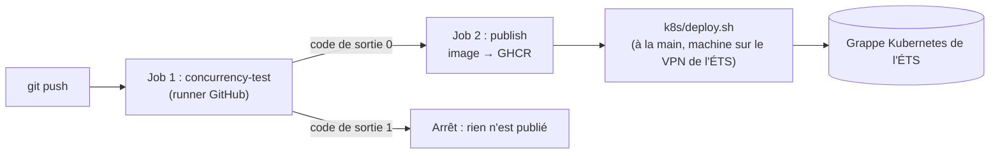

# Labo 09 – Activité 7 : pipeline CI/CD

## Vue d'ensemble



Fichiers :

| Fichier | Rôle |
|---|---|
| `.github/workflows/ci-cd.yml` | Pipeline lancé à chaque `push` (et manuellement avec `workflow_dispatch`) |
| `cockroach-db/src/tests/concurrency_test.py` | Test de concurrence, qui retourne maintenant un **code de sortie** |
| `k8s/deploy.sh` | Script de déploiement versionné, lancé à la main depuis le VPN |

## 1. Test de concurrence (job `concurrency-test`)

Le job démarre, sur le runner GitHub, la même grappe qu'en local : 3 nœuds CockroachDB, `cluster-init`, `db-init` et l'application. Il attend que `/health` réponde, puis lance le test avec 20 threads sur l'article 3 (stock initial : 2) :

```yaml
- name: Démarrer la grappe CockroachDB et l'application
  run: docker compose up -d --build cockroach1 cockroach2 cockroach3 cluster-init db-init python-app

- name: Lancer concurrency_test.py
  run: docker exec python_app_2 python tests/concurrency_test.py --threads 20 --product 3
```

Nous avons choisi `cockroach-db/`, car c'est la base déployée sur Kubernetes (activité 6), et elle n'a pas le problème de démarrage de `yugabyte2`.

### Pourquoi `concurrency_test.py` a été modifié

Dans sa version d'origine, le script **ne fait qu'afficher** les résultats et se termine toujours avec le code 0. Un pipeline ne peut donc pas savoir si le test a « échoué », et la consigne (« aucun déploiement ne doit partir si le test de concurrence échoue ») ne serait pas respectée.

Nous avons ajouté une vérification à la fin de chaque stratégie, sans changer l'affichage existant. Le script lit le stock de l'article avant et après les commandes simultanées, et considère le test réussi seulement si :

- le stock n'est **jamais négatif** (pas de survente) ;
- **au moins une** commande a réussi ;
- le nombre de commandes acceptées est **égal** au stock retiré (aucune commande acceptée sans que le stock baisse, aucune baisse sans commande).

```python
stock_after = get_stock(host, product_id)
passed = (stock_before is not None and stock_after is not None
          and stock_after >= 0
          and len(successes) >= 1
          and stock_before - stock_after == len(successes))
...
if not (pessimistic_ok and optimistic_ok):
    logger.debug("\n✘ Test de concurrence échoué.\n")
    sys.exit(1)
```

### Exécution locale des étapes du job

Mêmes commandes que dans le workflow :

```txt
$ docker compose up -d --build cockroach1 cockroach2 cockroach3 cluster-init db-init python-app
API prête après 10 s

$ docker exec python_app_2 python tests/concurrency_test.py --threads 20 --product 3
  Stratégie : Pessimiste (SELECT FOR UPDATE)
  Résultat : 2 commande(s) réussie(s), 18 échouée(s) sur 20 threads
  Latence moyenne (total)   : 0.134s
  Stock article 3 : 2 -> 0  (OK)
  Stratégie : Optimiste  (version + UPDATE conditionnel)
  Résultat : 2 commande(s) réussie(s), 18 échouée(s) sur 20 threads
  Latence moyenne (total)   : 0.219s
  Stock article 3 : 2 -> 0  (OK)
✔ Tests terminés.
EXIT CODE = 0
```

Vérification du blocage : si la vérification échoue (ici, un article inexistant), le script retourne 1. Dans GitHub Actions, l'étape échoue et le job `publish` n'est pas lancé :

```txt
$ docker exec python_app_2 python tests/concurrency_test.py --threads 5 --product 99
  Stock article 99 : None -> None  (ÉCHEC : stock incohérent)
✘ Test de concurrence échoué.
EXIT CODE = 1
```

## 2. Publication de l'image sur GHCR (job `publish`)

```yaml
publish:
  needs: concurrency-test        # ne démarre que si le test a réussi
  permissions:
    contents: read
    packages: write              # GITHUB_TOKEN suffit, aucun mot de passe stocké
```

- Image : `ghcr.io/youssefhamdouni/log430-labo9-a26` (contexte `cockroach-db/`). `docker/metadata-action` met le nom en minuscules, car GHCR refuse les majuscules.
- Étiquettes : `sha-<commit>` à chaque push (version traçable, retour en arrière possible), et `latest` **seulement sur `main`**, pour qu'une branche en cours ne remplace pas la version de référence.
- Le `Dockerfile` copie `.env` dans l'image. Comme ce fichier n'est pas versionné, les deux jobs le créent à partir de `.env.example`, qui ne contient aucun secret (`root`, sans mot de passe, comme en local).

## 3. Déploiement : choix d'un script lancé à la main

Les runners de GitHub sont hébergés hors du réseau de l'ÉTS et ne peuvent pas joindre la grappe. Le README propose deux voies. **Nous avons choisi le script versionné `k8s/deploy.sh`**, lancé depuis une machine connectée au VPN :

```bash
bash k8s/deploy.sh
```

Le script :
1. vérifie l'accès à la grappe (`kubectl auth whoami`) et s'arrête avec un message clair si le VPN n'est pas actif ;
2. applique `k8s/cockroachdb.yml` (le manifeste de l'activité 6) ;
3. attend les 3 pods (`kubectl rollout status statefulset/cockroachdb`) ;
4. initialise la grappe CockroachDB au premier déploiement (`cockroach init`), sans erreur si c'est déjà fait. Le script peut donc être relancé sans risque ;
5. affiche l'état des nœuds, des PVC et des Services.

### Pourquoi pas un runner auto-hébergé

| | Script à la main (choisi) | Runner auto-hébergé |
|---|---|---|
| Boucle CI/CD | Fermée jusqu'à GHCR. Le déploiement est une commande manuelle | Complètement automatique |
| Disponibilité | Fonctionne dès qu'un membre est sur le VPN | Seulement si la machine qui héberge le runner est allumée **et** connectée au VPN (le VPN de l'ÉTS demande une authentification interactive) |
| Sécurité | Les certificats `kubectl` restent sur le poste de chaque membre | La machine exécute le code de chaque push, avec les certificats de la grappe. Un workflow modifié sur une branche pourrait lancer n'importe quelle commande `kubectl` |
| Grappe partagée | Déploiement volontaire, au bon moment (l'espace de noms est partagé par l'équipe, la grappe par 25 équipes) | Chaque push sur `main` redéploie, même si un coéquipier utilise l'espace de noms |
| Mise en place | Aucune | Installer et maintenir le runner, gérer son jeton d'enregistrement |

Pour un laboratoire avec une grappe partagée et un accès par VPN, le script est plus simple, plus sûr et plus fiable. Le runner auto-hébergé serait le bon choix pour une équipe qui a une machine dédiée, toujours allumée, dans le réseau de l'ÉTS.

### Limite

Le manifeste `k8s/cockroachdb.yml` déploie seulement la base de données. L'image publiée sur GHCR n'est donc pas encore déployée sur la grappe. Pour la déployer, il faudrait ajouter un `Deployment` de l'application (image `ghcr.io/youssefhamdouni/log430-labo9-a26:latest`, `DB_HOST=cockroachdb-public`, comme indiqué dans `.env.example`) et un `kubectl rollout restart` à la fin du script.
