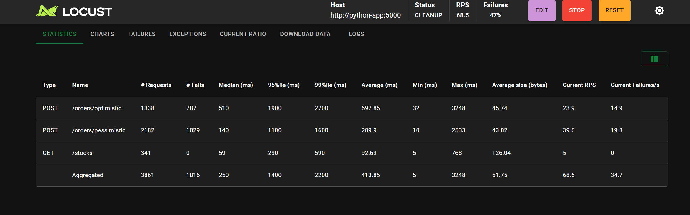
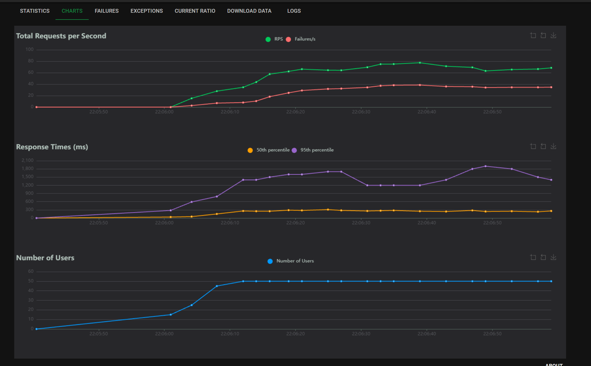
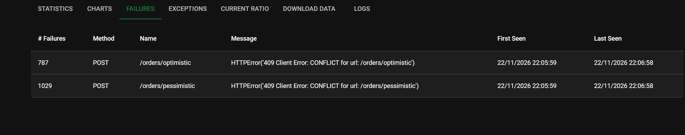
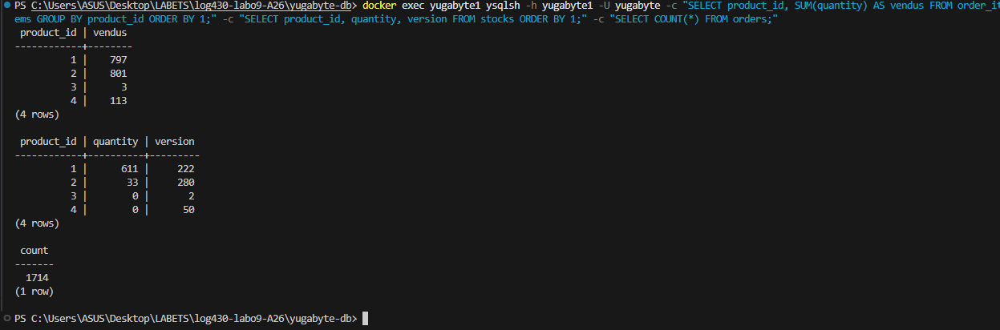

# Labo 09 – Question 4

> En utilisant YugabyteDB, quelle stratégie de verrouillage affiche le plus bas taux d'erreurs et la plus basse latence moyenne ?

## Test réalisé (activité 3)

- Cluster YugabyteDB à 3 nœuds (`yugabyte1`, `yugabyte2`, `yugabyte3`), stocks réinitialisés avec `POST /stocks/reset`.
- Locust : **50 utilisateurs**, spawn rate **5/s**, durée **60 s**.
- Le locustfile lance deux types d'utilisateurs **en même temps**, avec le même poids : `PessimisticOrderUser` appelle `POST /orders/pessimistic` et `OptimisticOrderUser` appelle `POST /orders/optimistic`. Les deux appellent aussi `GET /stocks` (1 fois sur 11). Les deux stratégies sont donc testées dans les mêmes conditions.





| Endpoint | Requêtes | Échecs | Taux d'échec | Médiane | Moyenne | 95e centile | 99e centile | Max |
|---|---|---|---|---|---|---|---|---|
| `POST /orders/optimistic` | 1338 | 787 | **58,8 %** | 510 ms | **698 ms** | 1900 ms | 2700 ms | 3248 ms |
| `POST /orders/pessimistic` | 2182 | 1029 | **47,2 %** | 140 ms | **290 ms** | 1100 ms | 1600 ms | 2533 ms |
| `GET /stocks` | 341 | 0 | 0 % | 59 ms | 93 ms | 290 ms | 590 ms | 768 ms |
| Total | 3861 | 1816 | 47 % | 250 ms | 414 ms | 1400 ms | 2200 ms | 3248 ms |

Débit : environ 65 à 75 requêtes/s une fois les 50 utilisateurs atteints.

## Réponse

**Le verrouillage pessimiste** a à la fois le plus bas taux d'erreurs (47,2 % contre 58,8 %) et la plus basse latence moyenne (290 ms contre 698 ms, soit environ 2,4 fois moins). Il a aussi traité 63 % de requêtes de plus (2182 contre 1338) dans le même temps, avec le même nombre d'utilisateurs.

**Pourquoi l'optimiste est plus lent ici.** Toutes les commandes portent sur seulement 4 produits, donc sur 4 lignes de la table `stocks` : la contention est très forte. Avec l'optimiste, deux transactions qui lisent la même `version` font tout le travail, mais une seule réussit son `UPDATE … WHERE version = :old_version`. L'autre fait un `rollback`, attend de 10 à 50 ms, puis recommence tout, jusqu'à 5 fois :

```python
# src/controllers/order_controller.py – create_order_optimistic
if result.rowcount == 0:
    # Conflict detected – retry
    session.rollback()
    time.sleep(random.uniform(0.01, 0.05))
    break
```

Avec beaucoup de conflits, ces tentatives ratées s'accumulent. Quand les 5 tentatives échouent, la commande est refusée alors que du stock existait peut-être encore. Le pessimiste, lui, fait **attendre** les transactions dans une file (`SELECT … FOR UPDATE`) : chacune passe à son tour, sans travail gaspillé. De plus, la version optimiste de Yugabyte exécute `ALTER TABLE stocks ADD COLUMN IF NOT EXISTS version …` (`_ensure_version_column`) au début de **chaque** commande. C'est une opération de schéma distribuée, coûteuse sur un cluster.

**Que représentent les « échecs » ?** Tous les échecs sont des `409 CONFLICT`. L'API renvoie 409 dès que la commande n'aboutit pas : stock insuffisant, conflit après 5 tentatives, ou erreur de base de données. Une grande partie des 409 est donc normale : il n'y a que 1592 unités en stock au total (1000 + 500 + 2 + 90), et les produits 3 et 4 sont épuisés très vite.

## Observation : vente au-delà du stock (incohérence)

Après le test, on a comparé les ventes avec le stock :

```sql
SELECT product_id, SUM(quantity) AS vendus FROM order_items GROUP BY product_id ORDER BY 1;
SELECT product_id, quantity, version FROM stocks ORDER BY 1;
SELECT COUNT(*) FROM orders;
```



| Produit | Stock initial | Vendus | Restant | Vendus + restant |
|---|---|---|---|---|
| 1 | 1000 | 797 | 611 | **1408** |
| 2 | 500 | **801** | 33 | **834** |
| 3 | 2 | **3** | 0 | 3 |
| 4 | 90 | **113** | 0 | 113 |

Locust compte 1704 commandes acceptées (551 en optimiste et 1153 en pessimiste), alors qu'il n'y a que 1592 unités en stock. Le produit 2 a été vendu 801 fois pour un stock de 500. **Les verrous ne protègent donc pas le stock quand les deux stratégies tournent en même temps.**

La cause est dans le code : la version pessimiste baisse la quantité **sans incrémenter `version`** :

```python
# create_order_pessimistic
stock.quantity -= qty          # la colonne version n'est pas modifiée
```

Une transaction optimiste qui a lu `(quantity, version)` juste avant ne voit donc aucun changement de version. Son `UPDATE … WHERE version = :old_version` réussit, et elle écrit une quantité calculée à partir d'une valeur périmée. Elle écrase ainsi la décrémentation faite par le pessimiste : c'est une **mise à jour perdue** (*lost update*). Le `SELECT … FOR UPDATE` ne protège que contre les transactions qui demandent aussi le verrou, et l'`UPDATE` optimiste ne le demande pas. Avec le niveau d'isolation utilisé par défaut ici, YugabyteDB n'a pas détecté ce conflit. Pour corriger, la version pessimiste devrait aussi faire `version = version + 1`, ou une seule stratégie devrait modifier une même ligne. Sur CockroachDB, le même test donne des stocks parfaitement cohérents (voir la question 6).
