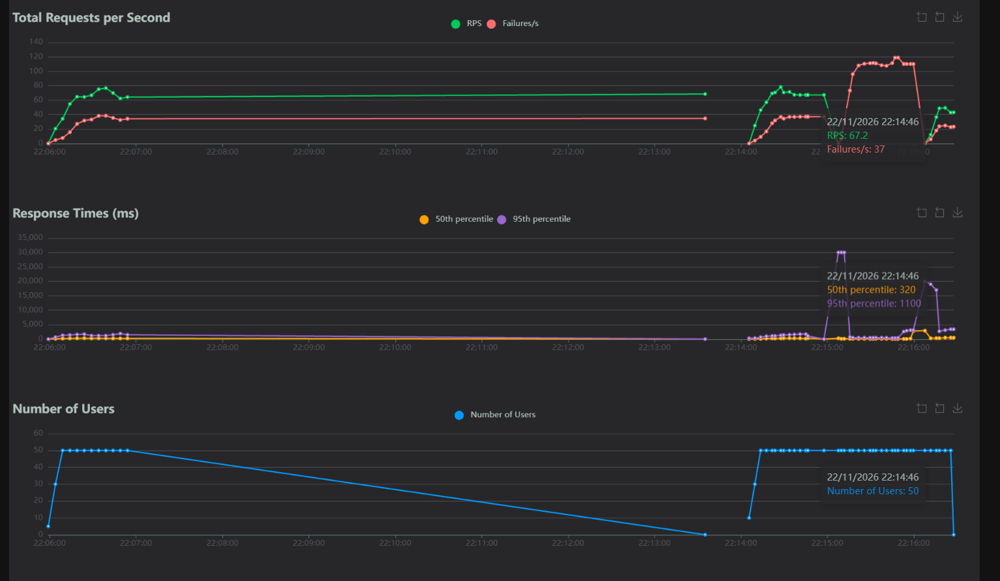
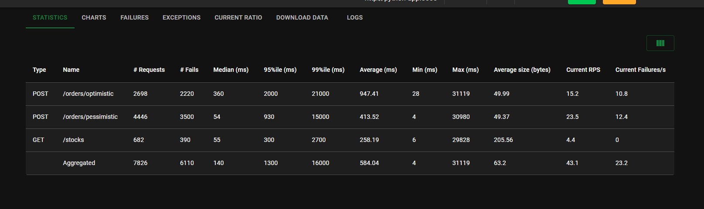
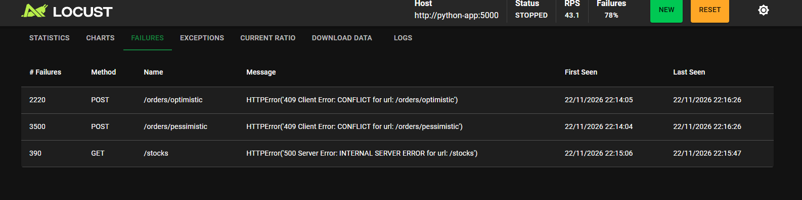

# Labo 09 – Question 5

> Est-ce que le taux d'erreur a augmenté lors de l'arrêt du nœud ? Combien de temps a duré le basculement (approximativement) ?

## Test réalisé (activité 4)

- Locust : 50 utilisateurs, spawn rate 5/s, **sans durée limite** (démarrage vers 22:14:00).
- Arrêt d'un nœud secondaire pendant le test : `docker stop yugabyte2` vers **22:15**.
- Redémarrage : `docker start yugabyte2` vers **22:16**, puis arrêt du test environ 30 s plus tard.

> Sur le graphique, la partie de gauche (22:06–22:07) est le test de l'activité 3. Le test de cette activité commence à 22:14. Les tableaux *Statistics* et *Failures* ne contiennent que ce test-ci.

| Endpoint | Requêtes | Échecs | Taux d'échec | Médiane | Moyenne | 99e centile | Max |
|---|---|---|---|---|---|---|---|
| `POST /orders/optimistic` | 2698 | 2220 | 82 % | 360 ms | 947 ms | 21 000 ms | 31 119 ms |
| `POST /orders/pessimistic` | 4446 | 3500 | 79 % | 54 ms | 414 ms | 15 000 ms | 30 980 ms |
| `GET /stocks` | 682 | **390** | **57 %** | 55 ms | 258 ms | 2700 ms | 29 828 ms |
| Total | 7826 | 6110 | **78 %** | 140 ms | 584 ms | 16 000 ms | 31 119 ms |

## Déroulement observé

| Période | Observation |
|---|---|
| 22:14:00 → ≈ 22:14:55 | Fonctionnement normal : environ 67 requêtes/s, environ 37 échecs/s (les 409 « stock insuffisant », comme à l'activité 3), médiane ≈ 320 ms, 95e centile ≈ 1100 ms |
| **≈ 22:14:55 → 22:15:05** | Arrêt de `yugabyte2` : le débit tombe presque à 0 et le 95e centile monte à **≈ 30 s**. Les requêtes restent bloquées en attendant que la base réponde |
| **≈ 22:15:05 → 22:15:50** | Pic d'erreurs : **110 à 120 échecs/s**, presque toutes les requêtes échouent. `GET /stocks`, qui n'avait jamais échoué, renvoie des **500 INTERNAL SERVER ERROR** de 22:15:06 à 22:15:47 |
| ≈ 22:15:50 | Le cluster s'est stabilisé sur les 2 nœuds restants |
| ≈ 22:15:55 → 22:16:10 | Redémarrage de `yugabyte2` : deuxième courte perturbation (95e centile ≈ 20 s) pendant que le nœud rejoint le cluster |
| après 22:16:10 | Retour à environ 45 requêtes/s et environ 22 échecs/s |

## Réponse

**Oui, le taux d'erreur a fortement augmenté.** Sur l'ensemble du test, il passe à **78 %**, contre 47 % pour le même test sans panne (activité 3). Le pic se situe juste après l'arrêt du nœud. Les erreurs ne sont plus seulement des refus pour stock insuffisant : la lecture `GET /stocks`, qui ne dépend d'aucun stock, échoue 390 fois avec des erreurs 500.

**Le basculement a duré environ 55 secondes** (≈ 22:14:55 → 22:15:50) : environ 10 s pendant lesquelles les requêtes restent bloquées (jusqu'à 30 s d'attente), puis environ 45 s d'erreurs. Le redémarrage du nœud cause ensuite une perturbation plus courte, d'environ 15 s.

**Pourquoi le service reprend tout seul.** Chaque table est découpée en *tablets*, et chaque tablet est répliqué sur les 3 nœuds, dont un seul est le *leader* qui accepte les écritures. Quand `yugabyte2` s'arrête, les tablets dont il était le leader n'ont plus de leader. Les deux réplicas restants détectent l'absence de signaux de vie et, grâce à l'algorithme de consensus **Raft**, élisent un nouveau leader parmi eux : avec 2 nœuds sur 3, la majorité (quorum) est conservée. Pendant ce temps, les requêtes qui touchent ces tablets attendent puis échouent. Ensuite, tout fonctionne de nouveau sans perte de données et sans intervention. L'application se connecte à `yugabyte1` (`DB_HOST=yugabyte1`), qui est resté en ligne : elle n'a donc pas eu besoin de changer de point d'entrée.

**Remarque.** Pendant la panne, les commandes en échec apparaissent quand même comme des **409** et non des 500. C'est parce que l'API transforme toute exception en 409 : `create_order_*` fait `return None`, puis la route renvoie `409 "Order failed (stock or constraint issue)"`. Une erreur de connexion à la base ressemble donc à un simple manque de stock. Seul `GET /stocks` montre la vraie nature du problème. Pour mieux surveiller ces pannes, il faudrait distinguer les erreurs métier (409) des erreurs techniques (503 ou 500).
