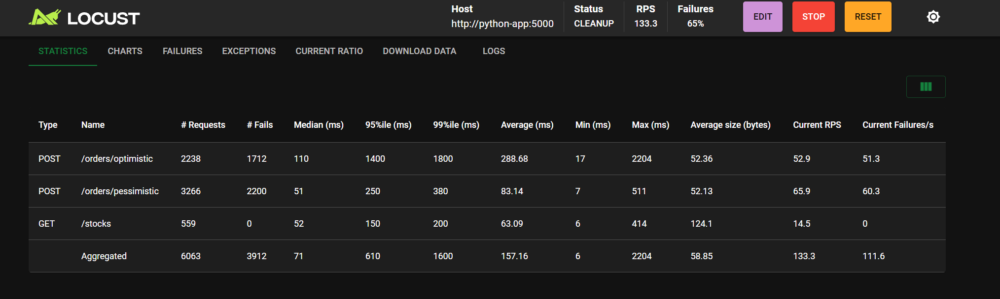
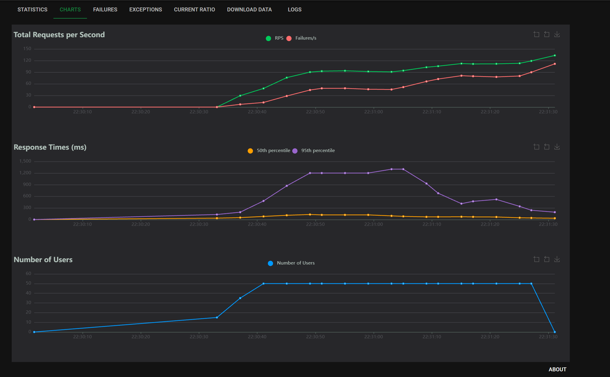
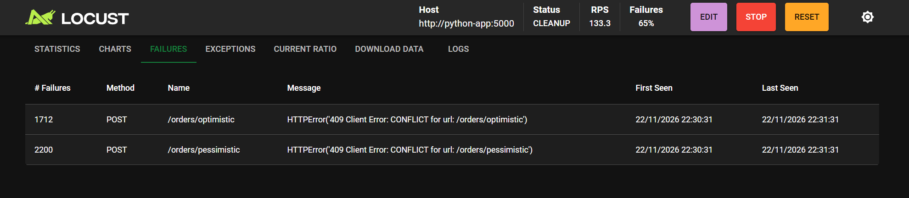
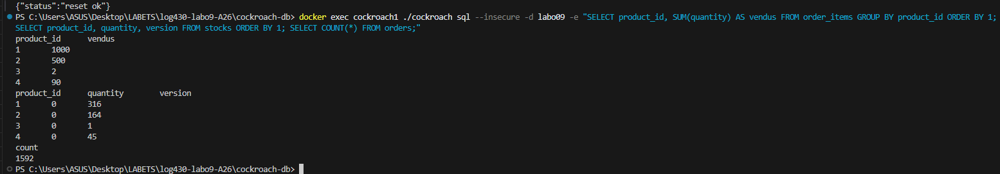

# Labo 09 – Question 6

> En utilisant CockroachDB, quelle stratégie de verrouillage affiche le plus bas taux d'erreurs et la plus basse latence ?

## Test réalisé (activité 5)

Mêmes paramètres qu'à l'activité 3 : cluster CockroachDB à 3 nœuds (`cockroach1`, `cockroach2`, `cockroach3`), stocks réinitialisés, Locust avec **50 utilisateurs**, spawn rate **5/s**, durée **60 s**, et les deux stratégies testées en même temps.





| Endpoint | Requêtes | Échecs | Taux d'échec | Médiane | Moyenne | 95e centile | 99e centile | Max |
|---|---|---|---|---|---|---|---|---|
| `POST /orders/optimistic` | 2238 | 1712 | **76,5 %** | 110 ms | **289 ms** | 1400 ms | 1800 ms | 2204 ms |
| `POST /orders/pessimistic` | 3266 | 2200 | **67,4 %** | 51 ms | **83 ms** | 250 ms | 380 ms | 511 ms |
| `GET /stocks` | 559 | 0 | 0 % | 52 ms | 63 ms | 150 ms | 200 ms | 414 ms |
| Total | 6063 | 3912 | 64,5 % | 71 ms | 157 ms | 610 ms | 1600 ms | 2204 ms |

Débit : environ 90 requêtes/s au début, jusqu'à 133 requêtes/s à la fin du test.

## Réponse

Comme avec YugabyteDB, **le verrouillage pessimiste** gagne sur les deux points :
- **le plus bas taux d'erreurs** : 67,4 % contre 76,5 % ;
- **la plus basse latence** : moyenne de 83 ms contre 289 ms (environ 3,5 fois moins), et 95e centile de 250 ms contre 1400 ms.

Il traite aussi 46 % de requêtes de plus (3266 contre 2238). La raison est la même qu'à la question 4 : toutes les commandes se disputent les mêmes 4 lignes de stock. Le pessimiste fait patienter les transactions dans une file, alors que l'optimiste perd du temps à refaire des transactions en conflit. Sur CockroachDB, ces conflits peuvent aussi produire des erreurs de sérialisation (code `40001`), que l'optimiste doit rejouer avec une pause croissante (`time.sleep(random.uniform(0.01, 0.1) * attempt)`).

**Pourquoi les taux d'échec sont élevés.** Tous les échecs sont des `409`, en majorité des refus pour stock insuffisant. CockroachDB a été assez rapide pour **vider tout le stock** pendant le test. Les ventes correspondent exactement au stock initial :

```sql
SELECT product_id, SUM(quantity) AS vendus FROM order_items GROUP BY product_id ORDER BY 1;
SELECT product_id, quantity, version FROM stocks ORDER BY 1;
SELECT COUNT(*) FROM orders;
```



| Produit | Stock initial | Vendus | Restant |
|---|---|---|---|
| 1 | 1000 | 1000 | 0 |
| 2 | 500 | 500 | 0 |
| 3 | 2 | 2 | 0 |
| 4 | 90 | 90 | 0 |

Il y a **1592 commandes**, ce qui correspond exactement aux 526 + 1066 commandes acceptées selon Locust et aux 1592 unités du stock initial. Une fois le stock vide, toutes les commandes suivantes sont refusées (409) très rapidement. C'est ce qui explique, sur le graphique, la montée des échecs/s jusqu'au niveau du débit après 22:31:05, et la baisse du 95e centile à la fin du test.

**Aucune vente au-delà du stock.** Contrairement à YugabyteDB, les deux stratégies peuvent tourner en même temps sans incohérence. Par défaut, CockroachDB exécute toutes les transactions en isolation **SERIALIZABLE**. Si une transaction optimiste a lu une ligne qu'une transaction pessimiste modifie avant la fin de la première, la base détecte le conflit et renvoie une erreur `40001`. Le code rejoue alors la transaction (`_is_retryable`) au lieu d'écrire une valeur périmée.
